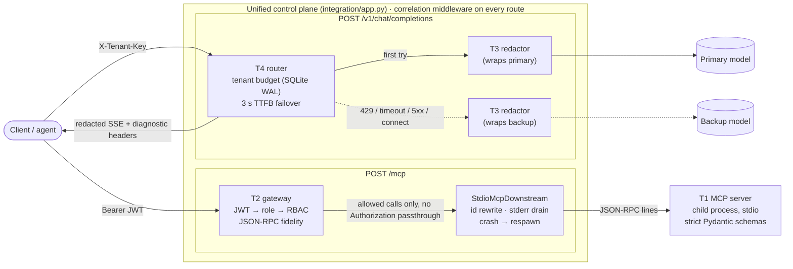
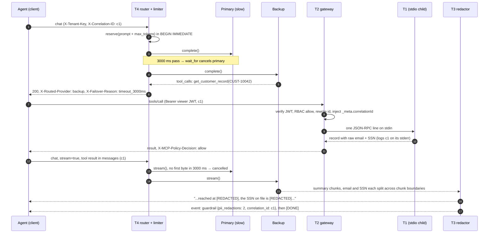

# Zero-trust AI & MCP control plane

[](https://github.com/RamNamala/zero-trust-ai-control-plane/actions/workflows/ci.yml)

The four assessment tasks are built as **one control plane** rather than four scripts. A strict
**STDIO MCP server** (Task 1) sits behind an **MCP security gateway** with JWT auth and per-tool
RBAC (Task 2). Model traffic goes through a **resilient router** with an on-disk SQLite token
budget and 3 s primary→backup failover (Task 4), and every model answer passes a **streaming
PII guardrail** (Task 3) on the way out. A single correlation ID follows a request through
every hop, including the T1 child process's stderr. An end-to-end demo drives one full agent
turn through all four, and 348 tests check every evaluation criterion.

Everything runs locally: upstream models and MCP servers are mocks, and nothing calls a paid
API.

## 60-second quickstart

```bash
uv sync                                   # Python 3.11+; installs into .venv
uv run pytest -q                          # 348 tests, ~90 s here (the 4 "slow" ones: ~14 s)
uv run python -m control_plane.e2e_demo   # scenarios A-E with real timings, ~16 s; exit 0 = all passed
```

With `make`: `make install test-all lint demo` (see `make help`; each target is the plain `uv`
command, so nothing needs `make`). `uv run python scripts/check_matrix.py --run` checks that
every acceptance-matrix row names a test that exists and passes.

`uv run python -m control_plane.e2e_demo --fast` runs the same scenarios with a 0.3 s failover
timeout. Demo logs go to `data/e2e_demo.log`, and the demo ends by printing a `grep` for
Scenario B's correlation ID.

**CI** ([`.github/workflows/ci.yml`](.github/workflows/ci.yml)) runs on every push, on Linux
with Python 3.11 and 3.13: ruff, mypy, all 348 tests and the matrix check, then the demo with
full 3 s timings. Open any run in the
[Actions tab](https://github.com/RamNamala/zero-trust-ai-control-plane/actions/workflows/ci.yml):
its summary page shows the demo's scenario-by-scenario checks, and the correlation-ID log is
attached as the `e2e-demo-log` artifact.

| Doc | For |
|---|---|
| [`docs/ACCEPTANCE_MATRIX.md`](docs/ACCEPTANCE_MATRIX.md) | every evaluation criterion → named test → status |
| [`TROUBLESHOOTING.md`](TROUBLESHOOTING.md) | field runbook: symptom → confirm → cause → fix |
| [`DESIGN_NOTES.md`](DESIGN_NOTES.md) | the decisions worth arguing about, with the alternatives |
| [`docs/PITFALLS.md`](docs/PITFALLS.md) | traps hit or avoided, with what verified each one |

## Architecture



**Scenario B** from the demo is one agent turn through every hop:



The topology is deliberate. Everything is in one process except T1, which is a real child
process because the task is about stdio. Redaction wraps *each provider* instead of sitting in
front of the router, so it applies to whichever provider answered. It also leaves the router's
failover logic intact (see [DESIGN_NOTES](DESIGN_NOTES.md#streaming-failover-only-before-the-first-byte)).

## The four tasks

### Task 1: STDIO MCP server (`src/control_plane/task1_mcp_server/`)
- **Asked:** `get_customer_record` and `trigger_refund` with strict validation, standard
  JSON-RPC errors, and stdout reserved for JSON-RPC.
- **How it's met:**
  - Pydantic v2 strict models with `extra="forbid"`, and `[0-9]` instead of `\d` (which would
    accept Unicode digits).
  - `amount` rejects strings, booleans, NaN and Infinity, and more than 2 decimals.
  - The `inputSchema` advertised in `tools/list` is generated from the same models.
  - Invalid arguments get JSON-RPC `-32602` on the wire, with no echo of the input. A
    well-formed request that fails business logic (unknown customer) gets
    `CallToolResult(isError=true)`.
- **Non-obvious decision:** stdout isolation happens at the **file-descriptor level**
  (`os.dup(1)` for the transport, `os.dup2(2, 1)` for everything else) before any other
  import. Rebinding `sys.stdout` alone misses C extensions, child processes, and modules that
  captured stdout earlier. The tests run with a chaos switch that deliberately `print()`s,
  logs and `os.write(1, …)`s, and assert stdout stays pure.
- **Proof:** [`tests/test_task1_mcp_server.py`](tests/test_task1_mcp_server.py), which uses the
  real subprocess and the official SDK client.

### Task 2: MCP security gateway (`src/control_plane/task2_mcp_gateway/`)
- **Asked:** read `Bearer` → role; forward `tools/list`; block `admin_*` calls for non-admins
  with `-32001` **without calling downstream**.
- **How it's met:**
  - HS256 JWT with `exp`/`nbf` checks and clock-skew leeway. Static and unsigned dev tokens
    are off by default.
  - Table-driven policy. Tool names must match a strict regex, which blocks
    `" admin_reset_key"`, zero-width characters and case tricks.
  - Full JSON-RPC 2.0 fidelity: ids preserved (`"7"` ≠ `7`, `null` kept), batches answered in
    the original order, notifications never answered, and an all-notification batch returns
    202 with an empty body.
  - The client's `Authorization` header is **never** forwarded downstream.
- **Non-obvious decision:** ids are **rewritten per hop**. The gateway sends internal integer
  ids downstream and restores the caller's id from its own records. Duplicate ids inside one
  batch, and concurrent clients that all use `id: 1` on the shared stdio pipe, therefore can't
  get each other's responses.
- **Proof:** [`tests/test_task2_mcp_gateway.py`](tests/test_task2_mcp_gateway.py). Denials are
  asserted against the mock downstream's call counter.

### Task 3: Streaming PII guardrail (`src/control_plane/task3_streaming_guardrail/`)
- **Asked:** redact emails, SSNs and card numbers from a streamed LLM response in real time,
  without buffering the response, and with low TTFT.
- **How it's met:**
  - One `StreamingPIIRedactor` per choice and per text field (`content`, `refusal`, each tool
    call's `arguments`); `logprobs` is dropped.
  - Each chunk emits everything up to the start of the trailing text that *could still become*
    PII, and holds back only that tail (bounded by `max_hold`, 256 chars).
  - Cards need Luhn plus 13–19 digits. SSN-shaped strings are redacted even in "invalid"
    ranges (fail closed).
  - The redaction count goes in a final `event: guardrail` SSE frame, because headers have
    already been sent by the time the count is known.
  - A client disconnect closes the upstream stream.
- **Non-obvious decision:** the hold-back is a **fixpoint over character classes**, not a
  fixed window. A fixed 36-char window leaks long emails and spaced card numbers.
  Hypothesis-based property tests assert that, for *any* chunking, the output equals
  `redact(full_text)`.
- **Proof:** [`tests/test_task3_guardrail.py`](tests/test_task3_guardrail.py), including the
  property tests, a 10k-chunk memory bound, and TTFT and disconnect checks under a real
  uvicorn server.

### Task 4: Rate limiter & failover router (`src/control_plane/task4_resilient_router/`)
- **Asked:** 50,000 tokens/minute per tenant in a sliding window on on-disk SQLite; fail over
  on 429 or a 3000 ms timeout; sanitized errors.
- **How it's met:**
  - The limiter is a ledger of rows in SQLite WAL. Check-and-reserve happens in one
    `BEGIN IMMEDIATE` transaction, plus an `asyncio.Lock` for coroutines that share the
    connection.
  - The hold (prompt estimate + `max_tokens`) is reconciled down to real usage afterwards, and
    released if nobody answered.
  - Tenant keys are stored only as sha256.
  - Failover happens on timeout, 429, 5xx and connection errors, but **not** on other 4xx.
  - `asyncio.wait_for` really cancels the slow primary.
  - Every error is a fixed envelope that never contains tracebacks, paths, SQL, internal URLs
    or keys.
- **Non-obvious decision:** for streams, the 3 s timeout is **time to first byte**. Failover
  is only possible before the first byte reaches the client. After that, a failure becomes an
  SSE `event: error` frame.
- **Proof:** [`tests/test_task4_router.py`](tests/test_task4_router.py), including the exact
  "50 of 100 concurrent reservations succeed" test, a multi-process test on a shared file, and
  leak checks.

### Integration (`src/control_plane/integration/`, `e2e_demo.py`)
- **Proof:** [`tests/test_e2e_integration.py`](tests/test_e2e_integration.py) covers
  scenarios A–E, a single correlation ID visible in all hops, 20 concurrent calls all with
  `id: 1`, and child crash → `-32603` → respawn.
  `test_scenario_b_full_pipeline_failover_tool_call_redaction` is the whole chain in one
  test: JWT auth → RBAC → T1 tool call over stdio → streamed PII redaction, with the primary
  timing out and the backup answering both model turns.

## Running each service standalone

Run each service in its own terminal from the repo root. The JWT helper signs with
`CP_JWT_HS256_SECRET` (the dev default if unset, with a warning), the same secret the gateway
reads:

```bash
eval "$(uv run python scripts/dev_tokens.py)"   # sets ADMIN_TOKEN and VIEWER_TOKEN (bash)
uv run python scripts/dev_tokens.py --role viewer   # or print one bare token
```

**T1: STDIO MCP server.**
```bash
(cat scripts/handshake.jsonl; sleep 1) | uv run python -m control_plane.task1_mcp_server 2>/dev/null | jq -c .
npx @modelcontextprotocol/inspector uv run python -m control_plane.task1_mcp_server        # Inspector UI
npx @modelcontextprotocol/inspector --cli uv run python -m control_plane.task1_mcp_server --method tools/list
```
`scripts/inspect_t1.sh` (and `CHAOS=1 ./scripts/inspect_t1.sh`) has calls worth trying in the
Inspector. Keep stdin open (`; sleep 1`) when piping a file: see TROUBLESHOOTING §1.

**T2: gateway (8100) → mock MCP downstream (8101).**
```bash
uv run python -m control_plane.task2_mcp_gateway.mock_downstream
uv run python -m control_plane.task2_mcp_gateway.proxy

curl -i http://127.0.0.1:8100/mcp -H "Authorization: Bearer $VIEWER_TOKEN" \
  -H 'Content-Type: application/json' -H 'X-Correlation-ID: readme-demo-0001' \
  -d '{"jsonrpc":"2.0","id":7,"method":"tools/call","params":{"name":"admin_reset_key","arguments":{"tenant":"acme"}}}'
```
```
HTTP/1.1 200 OK
x-mcp-caller-role: viewer
x-mcp-policy-decision: deny
x-correlation-id: readme-demo-0001

{"jsonrpc":"2.0","id":7,"error":{"code":-32001,"message":"Unauthorized Tool Call: Role 'viewer' is not permitted to invoke administrative tool 'admin_reset_key'."}}
```
With `$ADMIN_TOKEN` the same call returns `x-mcp-policy-decision: allow` and a result.
- A notification returns `202` with an empty body. No token returns `401` with
  `www-authenticate: Bearer`.
- `curl http://127.0.0.1:8101/__stats` shows what actually reached the downstream: no denied
  calls, and no `authorization` header.

**T3: guardrail (8200) → mock LLM (8201).**
```bash
uv run python -m control_plane.task3_streaming_guardrail.mock_llm
uv run python -m control_plane.task3_streaming_guardrail.gateway

curl -N -i http://127.0.0.1:8200/v1/chat/completions -H 'Content-Type: application/json' \
  -d '{"model":"mock-ssn_split","messages":[{"role":"user","content":"hi"}],"stream":true}'
```
```
HTTP/1.1 200 OK
cache-control: no-cache
x-accel-buffering: no
x-guardrail: pii-redaction/v1
content-type: text/event-stream; charset=utf-8
...
data: {... "delta": {"content": "My SSN is "} ...}
data: {... "delta": {"content": "[REDACTED]. "} ...}
data: {... "delta": {"content": "Thanks"} ...}
data: {... "delta": {}, "finish_reason": "stop"}
event: guardrail
data: {"pii_redactions": 1, "forced_flushes": 0, "correlation_id": "..."}
data: [DONE]
```
The upstream sent `123-`, `45-67`, `89. Thanks` as three separate chunks.
`model` picks a mock script: `mock-email_split`, `mock-card_split`, `mock-slow_long`,
`mock-error_midstream`, `mock-multi_choice`, …

**T4: router (8300).** This example points the primary at a dead port and the backup at the
mock LLM, so it shows failover:
```bash
CP_PRIMARY_PROVIDER_URL=http://127.0.0.1:8399/v1/chat/completions \
CP_BACKUP_PROVIDER_URL=http://127.0.0.1:8201/v1/chat/completions \
uv run python -m control_plane.task4_resilient_router.router

curl -i http://127.0.0.1:8300/v1/chat/completions -H 'Content-Type: application/json' \
  -H 'X-Tenant-Key: tenant-a' \
  -d '{"model":"mock-ssn_split","messages":[{"role":"user","content":"hi"}],"max_tokens":64}'
```
```
HTTP/1.1 200 OK
x-ratelimit-limit: 50000
x-ratelimit-remaining: 49987
x-ratelimit-window-seconds: 60
x-routed-provider: backup
x-failover-reason: connect_error
x-correlation-id: 43b87068-...
{"id":"chatcmpl-mock", ..., "gateway":{"routed_provider":"backup","failover_reason":"connect_error",...}}
```
Things to try:
- `"max_tokens":60000` → `413 REQUEST_TOO_LARGE` (retrying can never help).
- Four requests in a row with a 60,000-character prompt (~15k tokens each) → `200, 200, 200`,
  then `429` with `retry-after: 54`.
- Small sequential requests don't trip the limiter, because each hold is reconciled down to
  real usage.

On Windows, a refused connection to localhost takes ~2 s before it fails, so this request takes
~2 s.

**All of it together (8000).**
```bash
uv run uvicorn control_plane.integration.app:app --port 8000
```
`/mcp` takes a Bearer token and spawns T1 itself; `/v1/chat/completions` takes `X-Tenant-Key`.
The default primary sleeps 3.2 s, so you'll see `x-failover-reason: timeout_3000ms`.

## Benchmarks

Measured with `uv run python scripts/bench.py` (the full run takes ~16 s) on:
- **CPU:** Intel Core i5-14400F (16 logical cores)
- **OS:** Windows 11 (10.0.26300)
- **Python:** 3.14.0
- **SQLite file:** on the local SSD temp dir

T2 runs over in-process ASGI transport. TTFT is measured on loopback under uvicorn, because
ASGI transport buffers responses. Audit logging stays on (written to `os.devnull`).

| Task | Measurement | Result |
|---|---|---|
| T2 | `tools/call` direct to mock, p50 / p99 (2,000 calls) | 0.552 / 0.932 ms |
| T2 | `tools/call` via gateway, p50 / p99 (2,000 calls) | 1.388 / 2.062 ms |
| T2 | gateway overhead, p50 / p99 (difference) | 0.836 / 1.130 ms |
| T3 | redactor `feed()` per chunk, mean / p50 / p99 (50,000 chunks, 225,012 chars) | 2.02 / 2.00 / 4.20 µs |
| T3 | redactor peak buffer / redactions in stream | 33 chars / 185 |
| T3 | TTFT direct to mock, p50 / p99 (200 runs, loopback) | 3.98 / 5.95 ms |
| T3 | TTFT via guardrail, p50 / p99 (200 runs, loopback) | 7.59 / 10.61 ms |
| T3 | TTFT delta added by guardrail hop, p50 | 3.61 ms |
| T4 | `reserve()` + `reconcile()` on disk, p50 / p99 (2,000 sequential pairs) | 0.434 / 0.966 ms |
| T4 | throughput, 50 concurrent tasks x 100 pairs (one connection) | 1,041 pairs/s (4.80 s for 5,000) |

How to read these:
- **T2 overhead** (~0.8 ms p50) is JWT verification + policy + id rewrite + audit log + a
  second in-process HTTP hop.
- **T3 TTFT delta** (~3.6 ms) is mostly the extra HTTP hop through uvicorn and httpx; the
  redactor itself costs ~2 µs per chunk.
- **T4 throughput** is the *in-process* ceiling of one SQLite connection serialized by its
  lock. It came out **lower** than sequential (≈0.96 ms vs 0.43 ms per pair), probably from
  lock handoff and aiosqlite's thread wakeups under contention; that hasn't been investigated
  further.
- Multiple worker processes contend on the SQLite file lock instead. That path is tested for
  correctness, but not benchmarked.

These are this machine's numbers, not claims about production hardware.

## Known limitations, and what changes in production

| Here | In production |
|---|---|
| SQLite limiter, correct across processes on **one host** | Redis (Lua script or `CL.THROTTLE`) or Postgres for a budget shared across nodes. The `reserve`/`reconcile`/`release` interface stays the same. Host clock skew matters once the window is shared. |
| Table-driven RBAC in code (`policy.py`) | OPA/Rego or Cedar, so policy is versioned, reviewed and tested apart from the gateway, with decision logs. |
| HS256 shared secret | Asymmetric JWTs (RS256/ES256) verified against the IdP's JWKS with key rotation; `aud`/`iss` required. |
| Plain HTTP between hops | mTLS via a service mesh (Istio/Linkerd SPIFFE identities). The gateway's downstream credential would be a workload identity, not a static token. |
| `ceil(chars/4)` token estimate | The provider's tokenizer (tiktoken etc.), while still reconciling to the provider's reported `usage`. |
| Correlation ID in JSON logs | OpenTelemetry traces (W3C `traceparent`), with the MCP `_meta` slot carrying trace context into tool servers. |
| One T1 child per gateway process | A pool of downstream sessions, health checks and backpressure; per-tenant MCP sessions if tools hold state. |
| Regex PII detection (email, SSN, card) | A pluggable detector (e.g. Presidio, cloud DLP) for names, addresses and phone numbers, with per-tenant policies, and Unicode normalization (fullwidth digits, zero-width characters) before matching. Regexes stay as the fast first pass. |
| Mock providers and mock MCP downstream | Real providers behind the same `Provider` protocol (`HttpProvider` is there and tested). |
